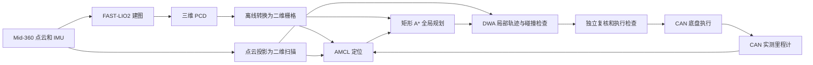

# SCOUT Mini + Livox Mid-360 自主导航项目完整说明书

适用环境为 Ubuntu 22.04、ROS 2 Humble，工作空间为 `~/scout_ws`。命令和参数按 2026-11-18 的工作空间整理。

## 1. 项目目标和当前进度

用 SCOUT Mini 四轮差速底盘和 Livox Mid-360 实现室内建图、地图定位、全局路径规划、低速自动行驶、局部避障和到点停车。建图数据由人工遥控采集，导航目标由操作者在 RViz 中选择。

实车已跑通从地图加载、初始定位、选目标到自主到达目标的流程。地图中临时加入箱子的试跑出现过停车和 TF 同步滞后，箱子绕行与堵路停车仍需分别验收。现有系统支持到点后再次选点，下一段路线需再次软件使能。



## 2. 方法和原理

### 2.1 FAST-LIO2 三维激光惯性建图

雷达提供三维点以及每个点在扫描帧内的时间偏移，IMU 提供角速度和加速度。FAST-LIO2 先用 IMU 推算这一帧内车辆怎么动，再把不同时间采到的点对齐到同一参考时刻，这一步叫去畸变。随后从当前扫描点附近查找地图点、拟合局部平面，用点到平面的误差修正姿态、位置、速度及 IMU 偏置等估计。更新后的点插入地图，供下一帧匹配。

它使用迭代误差状态卡尔曼滤波，将激光点匹配直接用于状态更新，并用增量 KD 树（ikd-Tree）维护地图点、执行近邻查找。这里的“直接”指可以用下采样后的原始激光点匹配，省去人工设计的边缘或平面特征提取。本项目使用 FAST-LIO 的 ROS 2 移植，关闭在线外参估计。建图轨迹仍可能累计漂移，当前流程未接入回环优化或预建 PCD 重定位。[FAST-LIO2 论文](https://arxiv.org/abs/2107.06829) · [上游源码](https://github.com/hku-mars/FAST_LIO) · [ROS 2 移植](https://github.com/Ericsii/FAST_LIO_ROS2/tree/ros2)

建图时 `/livox/lidar` 为 Livox `CustomMsg`，`/livox/imu` 提供 IMU。查看 `/cloud_registered` 可见配准后的扫描，`/Laser_map` 是累计点云，`/Odometry` 是激光惯性里程计。建图的主要 TF 是 `map → camera_init → body → base_link`。保存的 PCD 在 FAST-LIO2 的 `camera_init` 坐标中，后处理负责把它转换到导航使用的地图坐标。

### 2.2 三维点云转二维栅格

导航主要判断地面投影上哪里能通过。转换程序对 PCD 做有限值和距离过滤、体素下采样及孤立点过滤，按安装关系转换坐标，再拟合地面并校正高度。地面观测用于标记自由格，选定高度带内的障碍点投影到占用格，缺少证据的区域保持未知。

当前地图分辨率为 **0.05 m/格**，障碍高度带为离地 **0.10～0.75 m**。地图中白色是自由、黑色是占用、灰色是未知，未知格在规划中按不可通行处理。PGM 与 YAML 一起保存，YAML 中 `free_thresh: 0.196` 用于正确保留现有灰色编码的未知格。导航地图的坐标变换和生成统计分别保存在 `.frames.yaml` 和 `.report.json`。改装雷达后，应同步校正建图外参、PCD 转换的安装矩阵和导航 TF。

### 2.3 AMCL 和 CAN 里程计

`can_odometry` 读取底盘反馈的前进速度与转速并积分，发布 `/odom` 和 `odom → base_link`。AMCL 在保存的栅格地图上维护多组位姿假设，也叫粒子。车辆运动时，用里程计推进这些假设，再用当前激光扫描和地图的匹配程度更新权重、重采样。匹配好的假设获得更高权重，最终用估计的位置和朝向修正 `map → odom`。里程计提供连续的短时运动估计，AMCL 用地图约束累计漂移。当前配置采用差速运动模型和 likelihood field 激光模型，启动后需手动给定初始估计。[Nav2 Humble AMCL 源码](https://api.nav2.org/nav2-humble/html/amcl__node_8cpp_source.html)

导航主要使用 `map → odom → base_link → base_footprint`。Mid-360 原始 `PointCloud2` 在水平参考系 `livox_level` 投影成两份扫描。`/scan` 用于 AMCL，配置高度为离地约 0.10～0.75 m，最小横向量程 0.35 m。`/local_scan` 用于局部避障，配置高度为离地约 0.05～0.75 m，最小横向量程 0.15 m。高度对应平地安装条件，实际覆盖受视野、遮挡和地面起伏影响。

### 2.4 A* 全局路径规划

标准 A* 给搜索状态一个优先级 `f = g + h`。`g` 是已经付出的路径成本，`h` 估算离目标还有多远。优先展开估计总成本低的状态，找到可达目标后沿父状态回溯得到路线。[A* 原论文](https://doi.org/10.1109/TSSC.1968.300136)

本项目在 A* 思路上加入了车头朝向，搜索状态是 `(x, y, yaw)`。动作包括沿车头直行和原地转向，使用障碍距离场引导搜索。直行检查矩形扫过的整条带状区域，转向检查车角扫过的空间。车长 61 cm、宽 56 cm，四周各留 4 cm，碰撞矩形是 **69 × 64 cm**。因此一条窄路可能允许车辆正对通道走，却不允许在里面转身。目标箭头的方向也是搜索条件。

当前实现给启发式加权，并限制搜索时间和次数。搜索失败也可能与动作离散或超时有关，不能单凭失败判定通道实际无法通过。蓝色 `/global_path` 表示基于保存地图的路线。

### 2.5 DWA 局部避障和轨迹跟踪

DWA 即动态窗口法。每轮从当前实测速度出发，根据最大速度和一周期内可实现的加减速，选出多组候选线速度 `v` 和角速度 `ω`。差速底盘的平面运动可写成 `ẋ = v cos(yaw)`、`ẏ = v sin(yaw)`、`yaẇ = ω`。程序预测每组速度下未来约 2 秒的运动，并添加模型刹停尾段。矩形外廓与地图占用格、未知格或实时扫描点相交的候选会被淘汰。其余候选按贴近全局路线、对准前方目标、远离障碍和速度等因素评分。[DWA 原论文](https://doi.org/10.1109/100.580977)

本项目的 DWA 是自编实现。它输出橙色局部轨迹和短时间速度建议，经独立复核后进入执行节点。执行端再次核对输入时效、底盘状态和碰撞，并限制指令变化。箱子临时摆到路上时，蓝线可能保持原样，局部轨迹可在有空间时偏离蓝线绕行。DWA 只看有限的前方运动范围，遇到大范围封路时可能停车等待，不保证为临时障碍找到远距离绕行路线。

### 2.6 底盘执行与任务结束

执行链路为 `/local_planning/candidate_cmd → /local_planning/checked_cmd → scout_autonomy_controller → CAN`。软件默认未使能，底盘报告 CAN 模式 1 后才能申请软件使能。正常到达条件是目标距离约 15 cm 以内、朝向误差约 0.12 rad 以内，以及里程计和新鲜 CAN 反馈确认车已停稳。满足条件后报告 `GOAL_REACHED`，结束本次使能。

当前配置的前进指令上限为 **0.10 m/s**，角速度上限为 **0.40 rad/s**。执行端另检查实测速度，线速度超过 0.15 m/s 或角速度超过 0.50 rad/s 会触发硬保护逻辑。短时缺少可用候选时先请求零速度，正常输入恢复后最多在 1 秒等待窗口内继续同一任务。超时或故障会撤销使能，一次任务运行上限为 60 秒。软件发出零速度到实际停止的距离需在实车上测量。

### 2.7 TF 坐标系与变换

**TF 回答的是：同一个点，用另一个坐标系怎么表示？** 雷达测到的点起初用雷达自身的原点和轴来描述。要判断点会不会碰到车，就把它换算到车体坐标；要在 RViz 地图上显示这个点，就换算到地图坐标。ROS 消息头里 `frame_id` 说明坐标属于哪个参考系，`stamp` 说明测量对应哪个时刻。

一条 `父坐标系 → 子坐标系` 的 TF 记录子坐标系的原点和轴在父坐标系中的位置、方向。它包含平移 `x, y, z`（米）与旋转（TF 消息用四元数，RViz 和终端也可显示欧拉角）。例如 `base_link → livox_level` 的 `(0.130, 0, 0.326)` 表示从车体原点向前 13 cm、向上 32.6 cm 到雷达原点。在车体坐标约定中，X 向前、Y 向左、Z 向上。航向角 yaw 绕 Z 轴，俯仰角 pitch 绕 Y 轴。

#### 导航时的坐标树

```text
map                         保存地图的全局坐标
└── odom                    由 AMCL 将连续里程计对齐到地图
    └── base_link           由 CAN 里程计更新车体位置和朝向
        ├── base_footprint  车体在假定水平地面上的参考点
        └── livox_level     与雷达同原点，轴方向对齐车体
            └── livox_frame 雷达实际倾斜后的坐标系
```

| TF 边 | 谁发布 | 这一条变换的作用 |
|---|---|---|
| `map → odom` | AMCL，动态 `/tf` | 用保存地图和当前扫描校正里程计漂移，重设初始位姿时可能变化明显 |
| `odom → base_link` | 只读 `can_odometry`，动态 `/tf` | 用实测速度积分，给出连续的短时车体运动 |
| `base_link → base_footprint` | `robot_state_publisher`，静态 `/tf_static` | 车体坐标向下 0.079 m，给 AMCL 和规划提供平面参考 |
| `base_link → livox_level` | `robot_state_publisher`，静态 `/tf_static` | X 为 0.130 m、Z 为 0.326 m，旋转为零 |
| `livox_level → livox_frame` | `robot_state_publisher`，静态 `/tf_static` | 原点相同，当前模型绕 Y 轴旋转 +0.523599 rad，约 30° |

`base_link` 在模型的轮轴高度，因此雷达原点在平地上距地面约 `0.079 + 0.326 = 0.405 m`。`livox_level` 随车一起运动，在水平地面上与地面平行。如果小车上坡，它也会随车倾斜。`pointcloud_to_laserscan` 先把 `livox_frame` 的点转换到 `livox_level`，再按高度筛选并投影，因此高度参数以雷达原点为零。例如局部扫描的 `min_height=-0.355 m`，在平地上对应离地约 `0.405 - 0.355 = 0.050 m`。

如果 RViz 的 Fixed Frame 为 `map`，它就沿 TF 树把点云和车辆位置转换到地图坐标。车在走时，已定位的墙应在地图上基本保持原位。切到 `base_footprint`，观察视角随车移动，适合确认箱子相对于车头的位置。Fixed Frame 只改变观察坐标，导航仍使用原来的 TF。

#### FAST-LIO2 建图时的坐标树

建图入口使用 `map → camera_init → body → base_link`，下方再连接同一套车体和雷达静态变换。`camera_init` 是 FAST-LIO2 初始化的参考系，`body` 是当前 IMU 坐标。FAST-LIO2 发布动态的 `camera_init → body`。建图启动文件发布静态的 `map → camera_init` 和 `body → base_link`，分别设置初始地图显示关系、表达 IMU 和车体的固定安装关系。建图和导航分开运行，可以保证同一子坐标系只有一套发布来源。

#### 时间同步与常见报错

车辆移动时，同一个坐标系在不同时间的位置也不同。局部规划用当前可用的共同参考时刻，经 `odom` 把扫描时刻的障碍点换算到参考时刻的车体坐标，再检查轨迹。这样车转向时，较早采到的箱子点也能放到更合理的位置。动态 TF 查不到对应时刻时，这一轮可能没有有效速度。

- `WAITING_FOR_TF` 或提示坐标系不存在时，先核对当前启动模式的坐标树。导航模式再检查 `/odom`、`/scan` 及 AMCL 初始位姿。
- `TF_SYNC_LAG` 表示局部规划所用的定位 TF 相对里程计偏旧。当前默认允许相差最多 0.10 秒。反复出现时，对照 `/local_planning/status` 的 `tf_sync_lag_s`、`reference_age_s` 和 `planning_compute_ms`，再检查下面的里程计频率和 TF 链路。`tf_sync_lag_s` 在失败轮次可能为空，可同时看前后的成功样本。
- `extrapolation into the future` 表示请求的时刻晚于 TF 缓存里的最新变换，`extrapolation into the past` 表示请求早于缓存内最早的变换。RViz 偶尔丢弃旧显示消息时，可结合实时画面和规划状态判断影响。箱子避障验收时，先确认扫描与 TF 在测试期间持续可用。

#### 终端检查命令

先加载第 3.2 节的 ROS 环境，并启动对应系统。持续输出命令可按 Ctrl+C 结束查询。

```bash
# 查看雷达相对车体的安装平移与旋转
ros2 run tf2_ros tf2_echo base_link livox_frame

# 导航时，在完成初始定位后查看车体在地图中的位置
ros2 run tf2_ros tf2_echo map base_footprint

# 导航时检查动态 TF 链路的延迟与出现频率
ros2 run tf2_ros tf2_monitor map base_footprint
ros2 topic hz /odom

# 采样当前 TF 树并在工作目录生成 PDF
ros2 run tf2_tools view_frames
```

第一条应看到平移接近 `[0.130, 0.000, 0.326]`，俯仰角约 +30°。第二条随车的位置和朝向变化。建图时可改用 `ros2 run tf2_ros tf2_echo camera_init body` 查看 FAST-LIO2 估计的运动。RViz 也可通过 **Add → TF** 查看每个坐标系的轴和名称。

本项目的安装变换在模型中集中定义，建图和导航启动入口都会加载。改装雷达时，核对建图和导航两套入口的安装参数以及 PCD 转换标定，避免同时运行单独的 `lidar_tf.launch.py` 重复发布。[车体 Xacro](src/scout_ros2/scout_description/urdf/scout_mini.xacro) · [FAST-LIO2 启动与 TF](src/scout_mapping/launch/slam.launch.py) · [局部规划的 TF 查询](src/scout_avoidance/scout_avoidance/preview_inputs.py)

### 2.8 各节点的作用、输入和输出

**节点**是正在运行的功能单元，例如 `/amcl` 负责定位。**话题**是节点之间持续传数据的通道，例如 `/scan` 持续传输二维扫描。**服务**用于发出一次请求并等待结果，例如 `/map_save`。启动文件 `*.launch.py` 负责组织节点和传入参数。`pcd_to_grid` 是离线文件转换程序，读入 PCD、生成地图文件后退出。下面的表格使用当前启动配置中的 ROS 节点名。

#### 建图模式

| 节点 | 主要输入 | 主要输出与职责 |
|---|---|---|
| `/livox_lidar_publisher` | Mid-360 以太网数据 | 发布 `/livox/lidar`（`CustomMsg`，带逐点时间偏移）和 `/livox/imu` |
| `/robot_state_publisher` | 从 Xacro 生成的车体模型 | 发布机器人描述与固定关节 TF，包括车体到雷达 |
| `/fastlio_mapping` | `/livox/lidar`、`/livox/imu` | 去畸变、估计运动并累积点云，发布 `/cloud_registered`、`/Laser_map`、`/Odometry`、`/path` 和动态 TF。通过 `/map_save` 服务保存 PCD |
| `/map_to_fastlio_origin` | 建图启动时计算的初始安装关系 | 发布静态 `map → camera_init` |
| `/fastlio_body_to_base` | 建图启动时计算的 IMU 到车体外参 | 发布静态 `body → base_link` |
| `/rviz2` | FAST-LIO2 点云、轨迹和 TF | 显示采集效果，观察墙面、地面和轨迹是否合理 |

#### 导航模式

| 节点 | 主要输入 | 主要输出与职责 |
|---|---|---|
| `/livox_lidar_publisher` | Mid-360 以太网数据 | 此模式用 `PointCloud2` 发布 `/livox/lidar`，供两个投影节点使用，同时发布 `/livox/imu` |
| `/robot_state_publisher` | Xacro 车体模型 | 发布车体和雷达的静态 TF，供点云投影、定位、规划和 RViz 使用 |
| `/can_odometry_readonly` | USB-CAN 上的底盘状态和实测运动反馈 | 发布 `/odom`、`odom → base_link` 和 `/localization/can_diagnostics`，只读底盘 |
| `/localization_cloud_to_scan` | 原始点云和雷达 TF | 在 `livox_level` 中按定位高度带投影，发布 `/scan` 供 AMCL 匹配地图 |
| `/local_obstacle_cloud_to_scan` | 原始点云和雷达 TF | 用局部避障高度带投影，发布 `/local_scan`，保留较低和较近的障碍回波 |
| `/map_server` | 地图 YAML 和它引用的 PGM | 发布二维占用地图 `/map` |
| `/amcl` | `/map`、`/scan`、里程计 TF、RViz 发出的 `/initialpose` | 在地图中估计车辆位姿，发布 `/amcl_pose` 和 `map → odom` |
| `/lifecycle_manager_localization` | 启动配置中的节点列表 | 配置并激活 `/map_server` 与 `/amcl`，让它们进入可工作的生命周期状态 |
| `/scout_astar` | `/map`、`/goal_pose`、当前车体 TF | 规划蓝色全局路径 `/global_path`，发布 `/planning/status`，通过 `/planning/clear_goal` 清除目标。历史命名的 `/planning/inflated_map` 在当前实现中是地图兼容输出 |
| `/dwa_preview` | `/global_path`、`/map`、`/local_scan`、`/odom` 和 TF | 预测多组速度的轨迹并检查碰撞，发布 `/local_planning/candidate_cmd`、橙色 `/local_planning/local_path`、障碍和车体标记以及 `/local_planning/status` |
| `/candidate_guard_preview` | 候选速度及它自己收到的地图、局部扫描、路径、里程计和 TF | 用最新输入再次验证速度与碰撞，发布 `/local_planning/checked_cmd` 和 `/local_planning/guard_status` |
| `/scout_autonomy_controller` | 复核后的候选、自己的规划输入、底盘 CAN 反馈及新目标通知 | 检查输入时效、限幅并复核碰撞，管理使能、到点和停车。条件满足时通过 SocketCAN 发速度，发布 `/autonomy/status`，提供模式配置及使能服务 |
| `/rviz_local_preview` | 地图、TF、扫描、位姿、全局和局部路径 | 显示导航过程。**2D Pose Estimate** 发布 `/initialpose`，**2D Goal Pose** 发布 `/goal_pose` |

两个名字带 `preview` 的局部节点负责产生和复核速度。底盘执行由 `/scout_autonomy_controller` 控制，候选速度与复核速度都通过带时间戳的 `TwistStamped` 话题传递。导航全套入口会加载整个表，`local_planning_system.launch.py` 到独立复核为止，`localization_system.launch.py` 只启动定位层且窗口名为 `/rviz_localization`。单独的全局规划预览窗口名为 `/rviz_path_preview`。

例如点下 **2D Goal Pose** 后，可以依次观察 `/planning/status`、`/local_planning/status`、`/local_planning/guard_status`、`/autonomy/status`。蓝线有了但车还没走时，从局部规划开始查哪一级返回零速度或拒绝。添加箱子时，首先看 `/local_scan` 是否看到了它。

#### 查看正在运行的节点和数据接线

以下查询使用第 3.2 节的 ROS 环境。先运行对应系统，再在另一个终端查询。根据启动模式选择已运行的节点。

```bash
ros2 node list
ros2 node info /livox_lidar_publisher
ros2 node info /dwa_preview
ros2 node info /scout_autonomy_controller
ros2 topic info /local_scan --verbose
ros2 topic info /local_planning/checked_cmd --verbose
ros2 service list -t
```

`node info` 可以看到某个节点订阅什么、发布什么以及提供哪些服务。`topic info --verbose` 可以从一条话题反查发布者和订阅者。有图形桌面时，可用 `rqt_graph` 查看话题连接，需要时安装 `ros-humble-rqt-graph`。CAN 接线和节点内部计算需要结合底盘反馈与节点日志查看。

## 3. 硬件和工作空间配置

| 项目 | 当前设置 |
|---|---|
| 雷达以太网 | 雷达 `192.168.1.178`，主机 `192.168.1.5/32` |
| 专用网卡 | `enx00e04c10016b`，雷达定向路由通过这张网卡 |
| CAN | USB-CAN，`can0`，500000 bit/s，AGX_V2 |
| 车身参考点 | `base_link` 在模型轮轴中心，离地 0.079 m |
| 雷达安装 | `base_link → livox_frame` 平移 (0.130, 0, 0.326) m，pitch +0.523599 rad，雷达原点离地约 0.405 m |
| 整车外廓 | 长 0.61 m、宽 0.56 m、高 0.60 m |

连接雷达电源和网线，连接底盘 CAN 接线与 USB-CAN，确保底盘电源和遥控器可用。雷达 IP 曾按铭牌尾号核对，并已从有线网实测可达。若换雷达或网卡，先确认实际 IP 和接口名，然后修改下面的命令及驱动配置。驱动的 `src/livox_ros_driver2/config/MID360_config.json` 当前将命令、点云和 IMU 等主机 IP 指向 `192.168.1.5`，将雷达 IP 指向 `192.168.1.178`。驱动内部安装外参保留为零，车身安装姿态由 TF 表达。FAST-LIO2 配置中的雷达与 IMU 外参与车身安装外参各自独立。

### 3.1 依赖与构建

以下用于新环境或改过源码后重新编译。现有工作空间已经安装并构建，日常启动从 3.2 开始。迁移时复制本项目的 `src/`（保留 FAST-LIO2 的子模块和本项目修改）及 `maps/`，并在新机器重新构建。下列命令假定已安装 ROS 2 Humble 并配置 ROS 的 apt 软件源。

```bash
sudo apt update
sudo apt install build-essential cmake git python3-colcon-common-extensions python3-rosdep \
  python3-numpy python3-scipy python3-yaml libpcl-dev libeigen3-dev can-utils \
  ros-humble-rviz2 ros-humble-xacro ros-humble-robot-state-publisher \
  ros-humble-tf2-ros ros-humble-tf2-tools ros-humble-pointcloud-to-laserscan \
  ros-humble-nav2-map-server ros-humble-nav2-amcl ros-humble-nav2-lifecycle-manager \
  ros-humble-slam-toolbox

cd ~/scout_ws
source /opt/ros/humble/setup.bash
# 新机器首次使用 rosdep 时执行 sudo rosdep init，然后执行以下命令。
rosdep update
rosdep install --from-paths src --ignore-src --rosdistro humble -r -y
```

若机器缺少 Livox-SDK2，从厂家仓库安装。项目驱动在 ROS 2 环境中链接 `/usr/local/lib` 的 Livox SDK 共享库。 [Livox-SDK2 安装说明](https://github.com/Livox-SDK/Livox-SDK2)

```bash
mkdir -p ~/third_party
git clone https://github.com/Livox-SDK/Livox-SDK2.git ~/third_party/Livox-SDK2
cmake -S ~/third_party/Livox-SDK2 -B ~/third_party/Livox-SDK2/build
cmake --build ~/third_party/Livox-SDK2/build --parallel
sudo cmake --install ~/third_party/Livox-SDK2/build
sudo ldconfig
```

从项目带有的 ROS 2 源码构建。Livox 此版本需要 ROS 2 的 `package.xml`，当前工作区已设置好。如果迁移目录中缺少它，可从驱动自带的 `package_ROS2.xml` 复制。避免在现有工作空间运行驱动自带的 `build.sh`，该脚本会清除整个工作空间的构建及安装目录。

```bash
cd ~/scout_ws
source /opt/ros/humble/setup.bash
if [ ! -f src/livox_ros_driver2/package.xml ]; then
  cp src/livox_ros_driver2/package_ROS2.xml src/livox_ros_driver2/package.xml
fi
colcon build --symlink-install --cmake-args -DROS_EDITION=ROS2 -DDISTRO_ROS=humble
source install/setup.bash
```

### 3.2 每次重启后配置以太网和 CAN

```bash
ip -br link
sudo ip link set enx00e04c10016b up
sudo ip addr replace 192.168.1.5/32 dev enx00e04c10016b
sudo ip route replace 192.168.1.178/32 dev enx00e04c10016b src 192.168.1.5
ip route get 192.168.1.178
ping -I enx00e04c10016b -c 4 192.168.1.178

sudo ip link set can0 down
sudo ip link set can0 up type can bitrate 500000
ip -details link show can0
```

有线雷达使用专用路由，Wi-Fi 可继续上网。找不到 `can0` 时先检查 USB-CAN 是否被系统识别，找不到有线网卡时核对 `ip -br link`。以下所有运行 ROS 的终端均先执行：

```bash
cd ~/scout_ws
source /opt/ros/humble/setup.bash
source ~/scout_ws/install/setup.bash
```

## 4. 建图、保存和转换命令

如果继续用已经验证的 `maps/fastlio_nav_02.yaml`，可直接跳到第 5 节。重新建图时先停掉导航系统。两种模式会以不同消息类型发布同名的 `/livox/lidar`，还会分别建立地图坐标关系，因此每次只启动一套系统。

### 4.1 启动 FAST-LIO2

车辆在平地停稳启动，等点云与里程计出现后再遥控缓慢采集。尽量让墙面、拐角和地面被充分扫到，避免快速旋转。下面用新的文件名保存，重复采集时换名。

```bash
mkdir -p ~/scout_ws/maps
ros2 launch scout_bringup mapping_system.launch.py \
  map_save_path:="$HOME/scout_ws/maps/fastlio_lab_01.pcd"
```

另开终端并加载第 3.2 节环境，依次检查。频率命令按 Ctrl+C 退出后再执行下一条。

```bash
ros2 topic type /livox/lidar
ros2 topic hz /livox/imu
ros2 topic hz /cloud_registered
ros2 topic echo /Odometry nav_msgs/msg/Odometry --once --field header
```

在 RViz 中查看 `/Laser_map` 的累计点云和配准效果。采集完让小车停稳，在诊断终端调用保存服务，确认响应成功、文件非空后，再退出建图终端。

```bash
ros2 service call /map_save std_srvs/srv/Trigger '{}'
ls -lh ~/scout_ws/maps/fastlio_lab_01.pcd
```

### 4.2 生成二维地图

```bash
ros2 run scout_mapping pcd_to_grid \
  "$HOME/scout_ws/maps/fastlio_lab_01.pcd" \
  --output "$HOME/scout_ws/maps/fastlio_lab_nav_01" \
  --resolution 0.05 --min-height 0.10 --max-height 0.75

ls -lh ~/scout_ws/maps/fastlio_lab_nav_01.*
xdg-open ~/scout_ws/maps/fastlio_lab_nav_01.preview.png
```

先看预览中的墙边、通道和未知区是否合理。转换默认保护已有输出文件，重试可换输出名。后续加载这张新图时，把第 5、6 节命令的地图路径改成 `$HOME/scout_ws/maps/fastlio_lab_nav_01.yaml`，并让 YAML 与其引用的 PGM 保持在一起。

## 5. 定位和规划检查

下面三个入口逐级增加功能。一般用第三条整套检查入口即可，前三个命令只选一条运行，切换入口前先退出当前启动终端。

| 入口 | 用途 |
|---|---|
| `localization_system.launch.py` | 检查雷达、CAN 里程计和 AMCL |
| `local_planning_system.launch.py` | 增加全局路线、DWA 候选和独立复核 |
| `autonomy_system.launch.py hardware_enabled:=false` | 再增加执行节点的检查状态，此模式禁止 CAN 运动输出 |

```bash
# 只检查定位
ros2 launch scout_bringup localization_system.launch.py \
  map:="$HOME/scout_ws/maps/fastlio_nav_02.yaml"

# 或检查定位、全局与局部规划
ros2 launch scout_bringup local_planning_system.launch.py \
  map:="$HOME/scout_ws/maps/fastlio_nav_02.yaml"

# 或检查整条执行前链路
ros2 launch scout_bringup autonomy_system.launch.py \
  map:="$HOME/scout_ws/maps/fastlio_nav_02.yaml" hardware_enabled:=false
```

1. 在 RViz 确认固定坐标系为 `map`。
2. 点击 **2D Pose Estimate**，在车辆的实际位置按住鼠标，沿实际车头方向拖动再松开。红色扫描应与地图墙面基本重合，必要时在手动模式下缓慢移动，让定位收敛。
3. 点击 **2D Goal Pose**，选择空闲区域并拖动目标箭头。窄通道中，目标箭头宜沿通道方向。
4. 查看蓝色全局路线、橙色局部轨迹和绿色碰撞矩形。车停着时，起步候选通常只有约 0.02 m/s，橙色轨迹可能只有几厘米。

```bash
ros2 lifecycle get /map_server
ros2 lifecycle get /amcl
ros2 run tf2_ros tf2_echo map base_footprint
```

后面的状态查询命令显式指定消息类型，新终端已加载第 3.2 节环境即可执行。

```bash
ros2 topic echo /planning/status std_msgs/msg/String \
  --once --full-length --qos-durability transient_local \
  --qos-reliability reliable --qos-depth 1

ros2 topic echo /local_planning/status std_msgs/msg/String \
  --once --full-length --qos-durability transient_local \
  --qos-reliability reliable --qos-depth 1

ros2 topic echo /local_planning/guard_status std_msgs/msg/String \
  --once --full-length --qos-durability transient_local \
  --qos-reliability reliable --qos-depth 1
```

依次看到 `PATH_READY`、`CANDIDATE_READY`、`CHECKED_PREVIEW`，表示路线已生成且当前候选通过复核。整套检查入口还可读取 `/autonomy/status`，确认 `hardware_enabled=false`、`armed=false`、`can_frames_sent=0`。当前存在可执行且通过检查的候选时，`shadow_state` 为 `SHADOW_READY`。

## 6. 自动导航的完整启动与停止命令

### 6.1 启动和准备

退出之前的建图或检查入口，在启动终端执行下列命令。启动时保持软件未使能。使用同一套启动中的只读里程计与执行节点，避免同时启动旧底盘驱动、键盘控制或其他 CAN 运动发送程序。

```bash
cd ~/scout_ws
source /opt/ros/humble/setup.bash
source ~/scout_ws/install/setup.bash

ros2 launch scout_bringup autonomy_system.launch.py \
  map:="$HOME/scout_ws/maps/fastlio_nav_02.yaml" \
  interface:=can0 hardware_enabled:=true
```

此时执行第 5 节的 RViz 初始定位和目标设置。准备好遥控接管，在测试区域外观察，保持车辆停稳和摇杆回中。

### 6.2 检查 CAN 模式和使能

另开终端加载环境，执行：

```bash
ros2 topic echo /autonomy/status std_msgs/msg/String \
  --once --full-length --qos-durability transient_local \
  --qos-reliability reliable --qos-depth 1
```

- `control_mode=3` 表示遥控。切到实测反馈为 `0` 或 `1` 的档位。
- `control_mode=0` 表示待机。车辆停稳、`armed=false` 时调用下面的接口配置服务，再查实际模式。这个服务发送零速度和 CAN 接口配置，软件使能仍关闭。
- `control_mode=1` 表示 CAN 指令模式。保持该档位。

```bash
# 仅在待机模式 0 时使用
ros2 service call /autonomy/select_can_mode std_srvs/srv/Trigger '{}'
```

确认 `control_mode=1`、`can_mode_ready=true`、`can_healthy=true`、`shadow_state=SHADOW_READY`、`armed=false`。确认路线与场地后，执行使能。**车辆可能立即运动。** 遥控器切回手动档可接管。

```bash
ros2 service call /autonomy/enable std_srvs/srv/SetBool '{data: true}'
```

### 6.3 观察、停车和二次规划

持续查看状态，把输出和行驶表现对应起来。Ctrl+C 只会退出这个观察命令。

```bash
ros2 topic echo /autonomy/status std_msgs/msg/String \
  --field data --full-length --qos-durability transient_local \
  --qos-reliability reliable --qos-depth 1
```

`AUTONOMOUS` 表示正在执行。`GOAL_BRAKING` 表示已进入目标容差、正在等待停稳。`GOAL_REACHED` 且 `armed=false` 表示本次任务完成。到点后可以直接用 **2D Goal Pose** 设下一个点。等新蓝线和 `SHADOW_READY` 出现后，再手动使能一次。

软件停止命令如下。执行后观察实车是否已停稳。需要立即人工接管时切回遥控模式并使用现场硬件停止装置。

```bash
ros2 service call /autonomy/enable std_srvs/srv/SetBool '{data: false}'
```

如果要清除当前目标，先软件停止，再清空路线。确认车辆停稳后，在启动终端按 Ctrl+C 退出整套系统。

```bash
ros2 service call /planning/clear_goal std_srvs/srv/Trigger '{}'
```

## 7. 箱子避障验收和常见问题

实车先验收开阔场地到点和停止，再在无人行驶区域摆放静态箱子。箱子应在实时扫描高度范围内。在 RViz 先确认箱子处是否出现局部障碍点。验收绕行时给侧面留出车身和转向空间。验收堵路时，记录小车是否在接触前停车。临时箱子若未写入保存地图，蓝线保持原路线是预期现象。记录橙色轨迹、状态和小车是否真正到达，可以区分“已经避碰停车”和“已经绕行到点”。

| 现象或状态 | 检查与处理 |
|---|---|
| `/livox/lidar` 无数据 | 核对雷达供电、网卡路由、驱动主机 IP 和当前模式下的消息类型 |
| 缺少 `map → odom` | 查看 AMCL 生命周期是否 active，确认实际初始位置、扫描和 CAN 里程计 |
| `START_BLOCKED` / `GOAL_BLOCKED` | 检查对应位置和朝向的矩形是否碰到墙、地图边界或未知区域 |
| `SEARCH_TIME_LIMIT` / `NO_PATH` | 先用开阔处的近目标验证，检查地图连通性和目标方向 |
| `NO_CLEAR_CANDIDATE` / `COLLISION_CHECK_REJECTED` | 对照箱子位置、实时点和矩形。查看 `rejected` 或 reason。 `SCAN_COLLISION` 来源于实时扫描 |
| `TF_SYNC_LAG` / `STALE_ODOM` / `STALE_SCAN` | 核对 `/odom`、`/local_scan` 和 TF 的更新时间。此时的零候选不足以验收避障 |
| `NO_SAFE_COMMAND` / `PAUSE_TIMEOUT` | 当前没有可执行候选，或等待恢复超时。先查局部规划与复核状态 |
| `SELECT_CAN_MODE` / `CAN_MODE_LOST` | 查看实际 `control_mode`，按第 6.2 节确认配置和遥控档位 |
| `FEEDBACK_OVERSPEED` | 查看 `last_stop_details.latest_can_velocity`，检查实测速度与指令的差异 |
| 找不到状态话题 | 确认整套启动仍运行、新终端加载了同一 ROS 环境，并显式使用 `std_msgs/msg/String` 订阅 |

```bash
# 数据频率诊断，逐条运行
ros2 topic hz /odom
ros2 topic hz /scan
ros2 topic hz /local_scan
```

建议为每次试跑记录地图版本、起终点和方向、箱子位置及尺寸、是否绕行、实际停止位置、最终状态和日志。低于扫描高度下限、过于贴近雷达或被车体遮住的障碍可能漏检。验收应保留对这些盲区的记录，以及对停车距离和遥控接管的实车确认。

## 8. 配置文件与复现检查

| 内容 | 文件 |
|---|---|
| 雷达网络参数 | [MID360_config.json](src/livox_ros_driver2/config/MID360_config.json) |
| 雷达安装与车体模型 | [scout_mini.xacro](src/scout_ros2/scout_description/urdf/scout_mini.xacro) |
| FAST-LIO2 参数 | [fastlio_mid360.yaml](src/scout_mapping/config/fastlio_mid360.yaml) |
| 地图转换 | [pcd_to_grid.py](src/scout_mapping/scout_mapping/pcd_to_grid.py) |
| AMCL 与只读 CAN | [AMCL 参数](src/scout_localization/config/amcl_fastlio_grid.yaml)、[CAN 里程计](src/scout_localization/scout_localization/can_odometry.py) |
| 全局矩形规划 | [planner.yaml](src/scout_planning/config/planner.yaml)、[footprint_planner.py](src/scout_planning/scout_planning/footprint_planner.py) |
| 局部规划与扫描 | [local_preview.yaml](src/scout_avoidance/config/local_preview.yaml)、[local_scan.yaml](src/scout_avoidance/config/local_scan.yaml)、[local_planner_core.py](src/scout_avoidance/scout_avoidance/local_planner_core.py) |
| 执行与限速 | [autonomy.yaml](src/scout_control/config/autonomy.yaml)、[autonomy_controller.py](src/scout_control/scout_control/autonomy_controller.py) |
| 整套启动 | [建图入口](src/scout_bringup/launch/mapping_system.launch.py)、[实车导航入口](src/scout_bringup/launch/autonomy_system.launch.py) |

修改车体尺寸和安全余量时，要同步检查全局规划、局部规划和执行三处参数。修改导航限速时，保持局部规划与执行配置一致。修改雷达高度或倾角后，重新核对安装 TF、激光投影高度带和地图转换。

以下是离线验证和命令自查，可在未启动硬件的情况下执行。

```bash
cd ~/scout_ws
source /opt/ros/humble/setup.bash
source ~/scout_ws/install/setup.bash

ros2 launch scout_bringup mapping_system.launch.py --show-args
ros2 launch scout_bringup autonomy_system.launch.py --show-args
ros2 run scout_mapping pcd_to_grid --help

python3 -m unittest discover -s src/scout_planning/test -v
python3 -m unittest discover -s src/scout_avoidance/test -v
python3 -m unittest discover -s src/scout_control/test -v
python3 src/scout_control/test/simulate_goal_tracking.py
```

延伸阅读见 [FAST-LIO2 配置与代码](FASTLIO2_配置原理与代码说明.md)、[PCD 转二维地图](PCD转二维地图_使用说明.md)、[AMCL 定位](地图定位_AMCL配置与操作说明书.md)、[全局规划](全局路径规划_配置原理与操作说明书.md)、[局部避障](局部避障与路径跟踪_预览配置说明书.md)和[底盘执行](自动导航_配置原理代码与实车操作说明书.md)。
